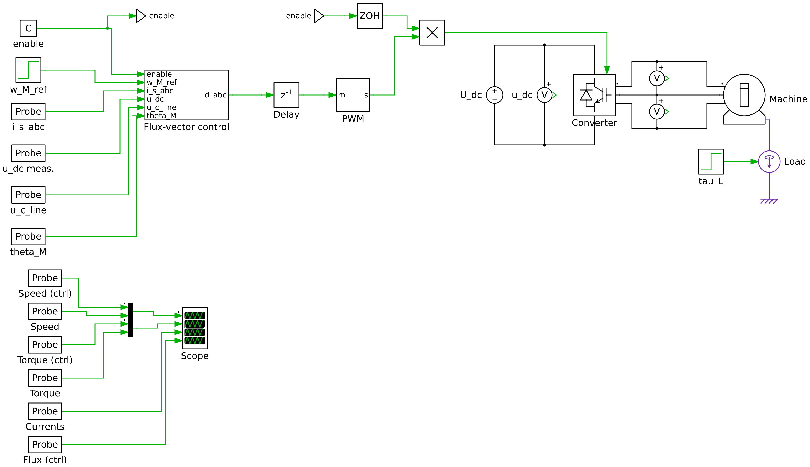

# motulator-export

Export [*motulator*](https://github.com/Aalto-Electric-Drives/motulator) drive systems and grid converter systems to [PLECS](https://www.plexim.com/products/plecs) and [Simulink](https://www.mathworks.com/products/simulink.html), and simulate them natively in C.

**Documentation:** https://aalto-electric-drives.github.io/motulator-export/

Build the system in *motulator* as usual, then:

```python
from motulator_export import native, plecs, simulink

plecs.write_model("drive.plecs", mdl, ctrl, t_stop=1.2)  # PLECS model
simulink.write_model("drive.slx", mdl, ctrl, t_stop=1.2)  # Simulink model
res = native.Simulation(mdl, ctrl).simulate(t_stop=1.2)  # Native simulation
```

<picture>
  <source media="(prefers-color-scheme: dark)" srcset="docs/source/images/plecs_drive_black.png">
  
</picture>

*PLECS model of a 2.2-kW IPMSM drive with sensorless flux-vector control, written by [examples/ipmsm_2kw_fvc.py](examples/ipmsm_2kw_fvc.py).*

- **One control code everywhere.** The control algorithms of *motulator* are ported to C. The same code runs in PLECS, in Simulink, and in the native simulation.
- **The structure of *motulator*.** Each class of the control system is a masked block with the arguments of its class, nested as in *motulator*. The parameters are set as in a *motulator* script, and they can be changed without Python.
- **Verified.** The PLECS and Simulink models agree with *motulator* to about 1e-6 relative to the signal magnitudes, and the native simulation to the rounding errors.
- **Fast.** The native simulation is 30 to 40 times faster than *motulator*, which is useful, e.g., for parameter sweeps.

## Installation

Python 3.12 or later. Clone the repository, which contains the examples, and install the package, which installs *motulator* 0.15.2 or a later 0.15 release:

```bash
git clone https://github.com/Aalto-Electric-Drives/motulator-export
cd motulator-export
pip install -e .
```

Then run an example, e.g., `python examples/ipmsm_2kw_fvc.py`, and open the model `examples/ipmsm_2kw_fvc.plecs` in PLECS. See the [documentation](https://aalto-electric-drives.github.io/motulator-export/guide/getting_started.html) for the requirements of PLECS, Simulink, and the native simulation.

## Development

Install the package with `pip install -e .[dev]` and run the tests with `pytest` (requires gcc). The implementation is described in the developer notes:

- [examples/README.md](examples/README.md): the structure of the PLECS models and their agreement with *motulator*
- [motulator_export/simulink/README.md](motulator_export/simulink/README.md): the structure of the Simulink models and their agreement with *motulator*
- [motulator_export/c/README.md](motulator_export/c/README.md): the C port of the control algorithms
- [motulator_export/matlab/README.md](motulator_export/matlab/README.md): the MATLAB port

## License

[MIT](LICENSE)
