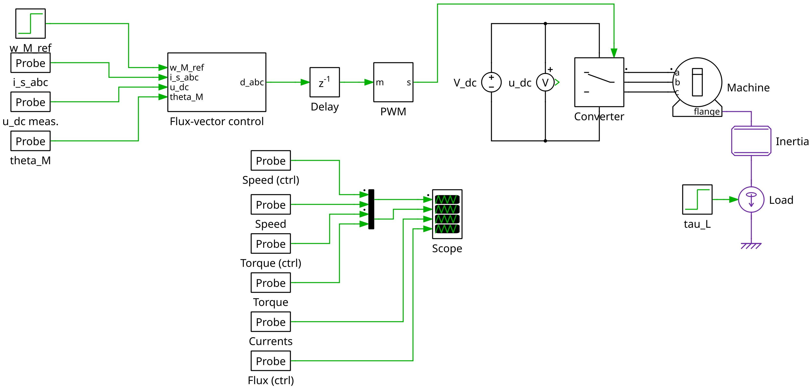
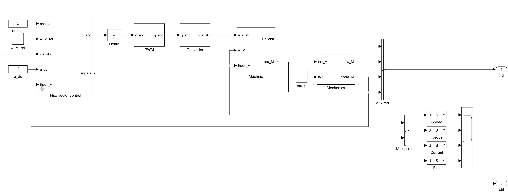

# motulator-export

Export [*motulator*](https://github.com/Aalto-Electric-Drives/motulator) drive systems and grid converter systems to [PLECS](https://www.plexim.com/products/plecs) and [Simulink](https://www.mathworks.com/products/simulink.html).

You build a system in *motulator*, as usual, and get a ready-to-run simulation model of it:

- **The same control code in both tools.** The control algorithms of *motulator* are ported to C, and the same C code runs in C-Script blocks in PLECS and in generated S-functions in Simulink. The C port is tested against *motulator* step by step. In Simulink, the blocks can instead be MATLAB Function blocks running a MATLAB port of the same code, which needs no C compiler.
- **The structure of *motulator*.** Each class of the control system (e.g., `FluxVectorController`, `SpeedFluxObserver`, `FluxObserver`, `SpeedController`, and `PWM`) is a block with a mask of the arguments of its class, in the hierarchy of *motulator*. The masks of the composite classes pass the parameters to the blocks inside them as the constructors of *motulator* do, so a class can be replaced or studied on its own.
- **Parameters as in *motulator*.** The parameters are defined in the model initialization as in a *motulator* example: the structs of the API (e.g., `par` of `SynchronousMachinePars`, `cfg` of `FluxVectorControllerCfg`, `speed_ctrl`, and `pwm`), with `[]` for the defaults. You can change the parameters without Python.
- **Verified against *motulator*.** The system model (the machine, the mechanics, the converter, and the grid) is built from native blocks, and the example scripts simulate each system in both tools and in *motulator*. The results agree to about 1e-6 relative to the signal magnitudes.

The same C code also runs natively: `native.Simulation` simulates a *motulator* system in C, with the interface and the results of *motulator*, but much faster, see [Native simulation](#native-simulation).

<picture>
  <source media="(prefers-color-scheme: dark)" srcset="examples/pmsyrm_6kw_gn_fvc_black.png">
  
</picture>

*PLECS model of a 5.6-kW PM-SyRM drive written by [examples/pmsyrm_6kw_gn_fvc.py](examples/pmsyrm_6kw_gn_fvc.py): the flux-vector control subsystem, the computational delay, the PWM, the converter, the machine with a GradNet model, the mechanics, and the scope.*

<picture>
  <source media="(prefers-color-scheme: dark)" srcset="examples/pmsyrm_6kw_gn_fvc_simulink_black.png">
  
</picture>

*Simulink model of the same drive written by [examples/pmsyrm_6kw_gn_fvc_simulink.py](examples/pmsyrm_6kw_gn_fvc_simulink.py), with the same C code of the control system in the S-functions of its blocks. The output ports `mdl` and `ctrl` give the signals for the comparison with* motulator.

## Requirements

- Python 3.12 or later. The package installs *motulator* 0.15.1 or a later 0.15 release.
- **PLECS**: PLECS Standalone. To simulate from Python, enable the RPC interface (Preferences > General > RPC interface, port 1080).
- **Native simulation**: a C compiler that supports `complex.h`, by default gcc (or the compiler given by the environment variable `CC`, e.g., clang).
- **Simulink**: MATLAB with Simulink (no other toolboxes) and a C compiler that supports `complex.h`: gcc (Linux), clang (macOS), or MinGW-w64 (Windows: the add-on *MATLAB Support for MinGW-w64 C/C++ Compiler*, selected with `mex -setup C`). MSVC does not work. The models with MATLAB Function blocks (`code="matlab"`) need no C compiler. To simulate from Python, install the MATLAB Engine API for Python matching your MATLAB release (e.g., `pip install matlabengine==26.1.*` for R2026a).

## Getting started

Clone the repository, which contains the examples, and install the package:

```bash
git clone https://github.com/Aalto-Electric-Drives/motulator-export
cd motulator-export
pip install -e .
```

Then run an example, which builds a drive of the *motulator* examples and writes its models:

```bash
python examples/ipmsm_2kw_fvc.py
python examples/ipmsm_2kw_fvc_simulink.py
```

- **PLECS**: open `examples/ipmsm_2kw_fvc.plecs` in PLECS and start the simulation. The scope shows the speed, the torque, the currents, and the flux linkage.
- **Simulink**: in MATLAB, run `examples/simulink/build_ipmsm_2kw_fvc.m`. It compiles the S-functions of the control system and saves `ipmsm_2kw_fvc.slx`, which runs the initialization script `init_ipmsm_2kw_fvc.m` (the parameters) after loading and at the start of each simulation. Without a C compiler, run `python examples/ipmsm_2kw_fvc_simulink.py --matlab` instead and then `build_ipmsm_2kw_fvc_matlab.m`, which saves the model with MATLAB Function blocks, `ipmsm_2kw_fvc_matlab.slx`.

If PLECS (with the RPC interface) or the MATLAB Engine API is available, the scripts also simulate the system in the tool and in *motulator* and print the maximum differences.

## Exporting your own system

Build the system in *motulator*, as usual, and write the models:

```python
import motulator.drive.control.sm as control
from motulator.drive import model

from motulator_export import StepSignal, plecs, simulink

# A motulator drive with carrier comparison (pwm=True) and its control system
par = model.SynchronousMachinePars(n_p=3, R_s=3.6, L_d=0.036, L_q=0.051, psi_f=0.545)
mdl = model.Drive(
    model.SynchronousMachine(par),
    model.MechanicalSystem(J=0.015),
    model.VoltageSourceConverter(u_dc=540),
    pwm=True,
)
speed_ctrl_args = {"J": 0.015, "alpha_s": 25.0}  # Arguments of SpeedController
ctrl = control.VectorControlSystem(
    control.FluxVectorController(par, control.FluxVectorControllerCfg(i_s_max=6.5)),
    control.SpeedController(**speed_ctrl_args),
)

# References and the load torque as step signals, and the stop time (s)
w_M_ref = StepSignal(time=0.1, after=50.0)  # Speed reference (mechanical rad/s)
tau_L = StepSignal(time=0.7, after=10.0)  # Load torque (Nm)
plecs.sm.write_model("ipmsm.plecs", mdl, ctrl, w_M_ref, tau_L, 1.2, speed_ctrl_args)
simulink.sm.write_model("ipmsm.slx", mdl, ctrl, w_M_ref, tau_L, 1.2, speed_ctrl_args)
```

This writes the PLECS model `ipmsm.plecs` and, for Simulink, the scripts `build_ipmsm.m` and `init_ipmsm.m` with the C sources of the S-functions (`sfun_*.c`) in the same folder.
With `simulink.sm.write_model(..., code="matlab")`, the Simulink model has MATLAB Function blocks instead: their functions (`mfun_*.m`) are written in the folder, and the build script copies them into the model.
The speed controller of *motulator* stores only its gains, so its arguments are given (`speed_ctrl_args`).
V/Hz control (`control.VHzControlSystem`, see `examples/im_2kw_vhz.py`) has no speed controller: `plecs.im.write_model("im_vhz.plecs", mdl, ctrl, w_M_ref, tau_L, 1.6)`.

The modules `sm` (synchronous machine drives), `im` (induction machine drives), and `grid` (grid converter systems) are the same in `plecs` and `simulink`.
A system that is not supported raises `NotImplementedError`, and an invalid argument `ValueError`, before any file is written.

The models start from the state of the system model. A drive can start at a given speed (e.g., `mdl.mechanics.state.w_M = 50.0`), but the other states (e.g., the flux linkages of the machine) are not exported, so write the models before simulating the system in *motulator*.

## Simulating from Python

`simulate` runs a model and returns the signals of the system model and the monitored signals of the control system, e.g., for comparing with *motulator*:

```python
import numpy as np

t_eval = np.linspace(0, 1.2, 1201)
# PLECS: the model needs the output ports (outputs=True), and PLECS the RPC interface
path = plecs.sm.write_model(
    "ipmsm_out.plecs", mdl, ctrl, w_M_ref, tau_L, 1.2, speed_ctrl_args, outputs=True
)
mdl_signals, ctrl_signals = plecs.sm.simulate(path, t_eval)
# Simulink: builds the model with the MATLAB Engine API and simulates it
mdl_signals, ctrl_signals = simulink.sm.simulate("ipmsm.slx", t_eval)
```

The controller of *motulator* evaluates the references at its sampling instants, whose times accumulate rounding errors, so a step at a sampling instant may switch at a different sample than in the tools. For an exact comparison, `sampled_step(sig, T_s)` gives the step that switches at the same sample as in *motulator*, as the example scripts use.

## Native simulation

`native.Simulation` simulates a system built in *motulator* in C: the control system runs as the C port of its algorithms, and the system model as C models of its subsystems, integrated by a C port of the simulation of *motulator* and the RK45 solver of scipy. Its interface and results are those of *motulator*, so a script only replaces the simulation object:

```python
from motulator.drive import utils

from motulator_export import native

sim = native.Simulation(mdl, ctrl)  # Instead of model.Simulation(mdl, ctrl)
res = sim.simulate(t_stop=1.75)
utils.plot(res, base)
```

The results are also stored in the time series of `mdl` and `ctrl`, as in *motulator*, and a subsequent call continues the simulation. The control system runs in C from its initial state. The library of the system type is compiled at the first use and cached in the temporary directory. The references and the load torque can be constants, functions of time (called from C), or `StepSignal` objects (evaluated in C, faster).

The native simulation takes the same solver steps as *motulator*, so the results agree to the rounding errors: about 1e-12 relative to the signal magnitudes, also with the GradNet models, see `tests/test_native.py`. With the carrier comparison (`pwm=True`), a rounding error can change a quantized duty ratio and thereby a switching instant, after which the solutions differ more; with a fine quantization (`CarrierComparison(N=2**24)`), they agree to about 1e-7. Similarly, the diode bridge (`DiodeBridgeDCBus`) clamps its inductor current at zero, which makes the step sizes sensitive to the rounding errors (differences of about 1e-7 to 1e-5, depending on the system and the simulated time). The closed-loop simulations of *motulator* itself are equally sensitive to the rounding errors.

Run times of `simulate` with *motulator* 0.15.0 (the wall time including the post-processing of the results, on one core of a laptop):

| System                                                                 | PWM model          | *motulator* | Native | Ratio |
| ---------------------------------------------------------------------- | ------------------ | ----------: | -----: | ----: |
| 5.6-kW PM-SyRM, GradNet models (`pmsyrm_6kw_gn_fvc_native.py`), 1.75 s | zero-order hold    |       9.9 s | 0.31 s |    32 |
| 5.6-kW PM-SyRM, GradNet models, 1.75 s                                 | carrier comparison |      27.9 s | 0.87 s |    32 |
| 2.2-kW IPMSM, sensorless FVC, 1.6 s                                    | zero-order hold    |       3.3 s | 0.09 s |    36 |
| 2.2-kW IPMSM, sensorless FVC, 1.6 s                                    | carrier comparison |       9.1 s | 0.24 s |    38 |

In the first case, the native run itself takes 0.17 s, and the rest is the post-processing of the results in Python, as in *motulator*.

The native simulation supports the drives and the grid converter systems of the table of [supported systems](#supported-systems), except the gate blocking (see the modules of `motulator_export/native/`); other systems raise `NotImplementedError`. The example `examples/pmsyrm_6kw_gn_fvc_native.py` simulates the GradNet example natively, and with `--compare` also in *motulator*.

## Examples

The [examples](examples/) build the systems of the *motulator* examples, write the models, and, if the tool is available, simulate them both in the tool and in *motulator* and print the maximum differences.

| System                                                                                        | PLECS                                                                    | Simulink                        |
| --------------------------------------------------------------------------------------------- | ------------------------------------------------------------------------ | ------------------------------- |
| 2.2-kW IPMSM, sensorless flux-vector control                                                  | `ipmsm_2kw_fvc.py` (`--diode`: diode bridge; `--blocked`: gates blocked) | `ipmsm_2kw_fvc_simulink.py`     |
| 5.6-kW PM-SyRM, GradNet models from FEM data, flux-vector control                             | `pmsyrm_6kw_gn_fvc.py`                                                   | `pmsyrm_6kw_gn_fvc_simulink.py` |
| 2.2-kW induction machine, sensorless current-vector control                                   | `im_2kw_cvc.py`                                                          | `im_2kw_cvc_simulink.py`        |
| 2.2-kW induction machine, observer-based V/Hz control (`--open-loop`: open-loop V/Hz control) | `im_2kw_vhz.py`                                                          | `im_2kw_vhz_simulink.py`        |
| 10-kVA grid converter, LCL filter, grid-following control                                     | `gfl_10kva_lcl.py`                                                       | `gfl_10kva_lcl_simulink.py`     |
| 12.5-kVA grid converter, weak grid, grid-forming control                                      | `gfm_13kva_do.py`                                                        | `gfm_13kva_do_simulink.py`      |

## Supported systems

| Feature                                                                                                 | PLECS  |   Simulink   | Native |
| ------------------------------------------------------------------------------------------------------- | :----: | :----------: | :----: |
| Synchronous machine drives: flux-vector control (constant inductances or GradNet models), speed control |  yes   |     yes      |  yes   |
| Induction machine drives: current-vector control (constant parameters), speed control                   |  yes   |     yes      |  yes   |
| Induction machine drives: observer-based V/Hz control, including open-loop V/Hz control (`L_M = inf`)   |  yes   |     yes      |  yes   |
| Grid-following control (current-vector control with a PLL)                                              |  yes   |     yes      |  yes   |
| Grid-forming control (disturbance observer)                                                             |  yes   |     yes      |  yes   |
| Stiff DC bus                                                                                            |  yes   |     yes      |  yes   |
| Capacitive or diode-bridge-fed DC bus (`DCBus`, `DiodeBridgeDCBus`)                                     | drives |      no      |  yes   |
| Dead time and threshold voltage of the converter in the system model                                    | drives |      no      |  yes   |
| Compensation of the dead time and the threshold voltage in the control system (drives)                  |  yes   |     yes      |  yes   |
| Single update of the duty ratios in the system model (`single_update`)                                  |  yes   |      no      |  yes   |
| Gate blocking (`set_enable`): the control system, and the system model                                  |  yes   | control only |   no   |

The drives can be sensorless or sensored.
In the PLECS and Simulink models, the converter uses carrier comparison (`pwm=True`) with the computational delay of one sampling period, grid-following control is supported with an LCL filter without resistances and grid impedance and grid-forming control with an L filter and the grid inductance, and the grid is balanced with constant voltage and frequency.
The native simulation is more general: it supports both filters with their resistances and the grid impedance with either control, the source with the magnitudes, the phase shifts, and the frequency as functions of time (e.g., voltage dips and negative-sequence components), the zero-order hold (the default of *motulator*), other computational delays, and the friction coefficient of the mechanics as a function of the speed; its synchronous machine model has constant inductances or a GradNet current map with spatial harmonics.
Other configurations raise `NotImplementedError` when the model is written or the native simulation is created.

## Working with the models

- **Parameters** are defined in the initialization commands of the PLECS model (Simulation > Simulation Parameters > Initialization) and in the script `init_<model>.m` of the Simulink model: the system model (e.g., `machine`, `mechanics`, and `converter`) and the structs of the control system (e.g., `par`, `cfg`, `speed_ctrl`, and `pwm`). An empty parameter (`[]`) corresponds to `None` in *motulator*, i.e., the default.
- **Control system**: the subsystem named after the control method (e.g., `Flux-vector control`) contains the blocks of the classes. Their masks show the arguments of the classes; the top-level blocks refer to the structs of the model initialization, and the blocks inside them get their parameters from the masks of their parents, whose initialization resolves the defaults as *motulator* does. Derived quantities, such as the gains and the lookup tables, are computed by the code of the blocks at the start of the simulation (in Simulink, the lookup tables of the control loci of synchronous machines by the function `sm_reference_luts.m` next to the model, in the mask initialization). The monitored signals are the mask probes of the subsystem (PLECS) and its output `signals` (Simulink).
- **Input `enable`**: the first input of the control system is the gate enable of *motulator* (`ctrl.set_enable`, a constant or a `StepSignal` of 0 and 1, by default 1). While it is zero, the gates of the converter are blocked, and the control system runs in standby, as in *motulator*: its observers track the system using the measured converter voltages (the input `u_c_line`, the line-to-line voltages u_ab and u_bc), its controller tracks the measured operating point, from which the control continues when the gates are released, and the speed controller is not updated. In PLECS, the gates of the IGBT converter are blocked (all switches off, the diodes conducting according to the currents). The Simulink system model does not block the gates (the input is 1 and `u_c_line` zero), but the control system supports it, e.g., on the hardware. The measured DC-bus voltage is limited to at least 1 V.
- **C sources**: the PLECS models and the S-functions refer to the C files of the package by a path relative to the model file, so write the model again if you move it relative to the package. The Simulink models with MATLAB Function blocks contain their code.
- **S-functions**: a compiled S-function stays loaded in MATLAB after its model is closed, so run `clear mex` before rebuilding a model that was open (on Windows, the compiled file cannot be overwritten while it is loaded).

## Documentation

- [examples/README.md](examples/README.md): the structure of the PLECS models and their agreement with *motulator*
- [motulator_export/simulink/README.md](motulator_export/simulink/README.md): the Simulink export, the structure of the models, and their agreement with *motulator*
- [motulator_export/c/README.md](motulator_export/c/README.md): the C port of the control algorithms and its tests
- [motulator_export/matlab/README.md](motulator_export/matlab/README.md): the MATLAB port of the MATLAB Function blocks and its tests

## Development

Install the package in editable mode with the development tools, `pip install -e .[dev]`.
The tests (`pytest`) compile the C sources with gcc and compare the C port and the generated S-functions of the blocks of the control systems with *motulator*, with the parameters computed from the model initialization through the masks; neither PLECS nor MATLAB is needed. The tests of the MATLAB Function blocks (`tests/test_matlab_function.py`) run them in Simulink and are skipped without the MATLAB Engine API.
On Windows, the MinGW-w64 gcc of MATLAB can be used by adding its `bin` folder to the PATH.

## License

[MIT](LICENSE)
